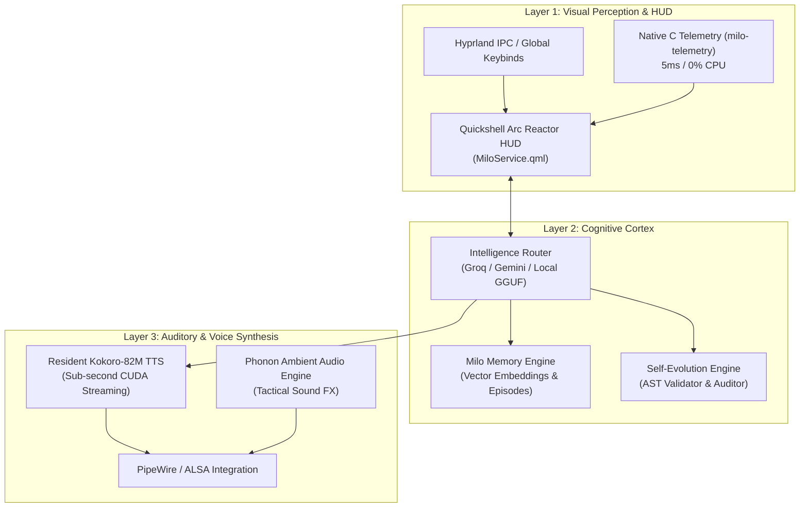

# 🌌 MiloOS // Sovereign AI Ambient Operating System

[](https://archlinux.org/)
[](https://hyprland.org/)
[](https://quickshell.outfoxxed.me/)
[](https://huggingface.co/hexgrad/Kokoro-82M)
[](https://opensource.org/licenses/MIT)

**MiloOS** is a sovereign, resident AI operating system layer engineered for power developers on **Arch Linux + Hyprland**. It combines a real-time reactive **Quickshell Arc Reactor HUD**, resident CUDA-accelerated **Kokoro-82M TTS**, a multi-model **Cognitive Cortex** routing layer, and an autonomous self-evolution engine over **70+ custom native binaries**.

---

## ⚡ The Tactical Trinity Architecture

Milo is built upon an asynchronous, zero-latency tripartite loop:



---

## 🚀 Key Features

* **🏎️ Zero-Latency Native C Telemetry**: Replaced heavy `/proc` scanning scripts with a custom compiled C binary (`milo-telemetry.c`) that outputs RAM, CPU cores, thermals, and disk statistics in **5 milliseconds (0.005s) with 0.0% CPU overhead**.
* **🎙️ Resident CUDA Voice Engine**: Sub-second text-to-speech powered by Kokoro-82M running locally on GPU VRAM, providing natural conversational responses without cloud latency.
* **🧠 Multi-Tier Cognitive Cortex**: Dynamically routes queries between ultra-fast Groq LLaMA models, Google Gemini for complex reasoning, and offline local GGUF models.
* **🛡️ Self-Evolution & AST Auditing Engine**: Built-in runtime supervisor (`milo-evolve`) that audits, syntax-verifies, and stages code changes with automatic rollback protection.
* **🎮 Gaming & Productivity Isolator**: Toggleable `milo-game` mode that suppresses non-critical background timers, suspends heavy AI loops, and unleashes full GPU/CPU headroom for low-latency tasks.
* **🔔 Tactical Phonon Auditory Matrix**: Subtle ambient audio cues for command execution, alerts, evolution approvals, and system state transitions.

---

## 🧰 CLI Command Suite (Highlights)

Milo includes 70+ specialized executables in `bin/`:

| Binary | Description |
| :--- | :--- |
| `milo` | Master entrypoint and quick-command dispatcher. |
| `milo-doctor` | Comprehensive system health check (daemons, thermals, VRAM, audio). |
| `milo-evolve` | Self-evolution engine (`audit`, `diff`, `plan`, `approve`, `rollback`). |
| `milo-speak` | Real-time CLI speech synthesis pipe to Kokoro daemon. |
| `milo-game` | High-performance low-latency gaming mode switch. |
| `milo-cortex-hud`| Interactive floating terminal interface for Cognitive Core. |
| `milo-music` | MPRIS-integrated audio player for local FLAC/MP3 vaults. |
| `milo-phone` | Seamless companion bridging (ADB, notifications, battery sync). |
| `milo-telemetry` | Ultra-fast native C hardware telemetry daemon. |

---

## 📋 System Requirements

* **OS**: Arch Linux (or modern rolling-release Linux distribution).
* **Display Server**: Wayland with [Hyprland](https://hyprland.org/).
* **Desktop Shell**: [Quickshell](https://quickshell.outfoxxed.me/) (v0.0.8+).
* **GPU**: NVIDIA GPU with CUDA drivers (GTX 1650 or higher; Kokoro-82M requires ~400MB VRAM).
* **Audio**: PipeWire with `pipewire-pulse` and `wireplumber`.
* **Runtime**: Python 3.11+ and GCC.

---

## 📥 Installation

Clone the repository and run the automated bootstrap:

```bash
git clone https://github.com/yourusername/milo-os.git
cd milo-os
./install.sh
```

### Configure Your Intelligence Keys
Edit `~/.config/milo/keys.env` to add your preferred API keys:

```bash
GROQ_API_KEY=your_groq_key_here
GEMINI_API_KEY=your_gemini_key_here
```

### Start System Daemons
Enable and start the user-level resident services:

```bash
systemctl --user enable --now milo-cortex.service milo-voice.service milo-sentinel.service
```

Verify your setup:

```bash
milo-doctor
milo-speak "Milo online and fully operational, sir."
```

---

## 📜 License

Distributed under the **MIT License**. See [`LICENSE`](LICENSE) for details.
